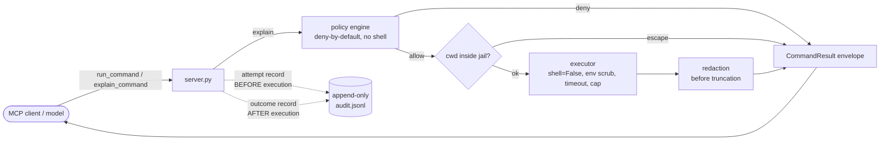

# hardened-terminal-mcp

A security-hardened [MCP](https://modelcontextprotocol.io) server that lets an AI
model run a **small, explicitly allowlisted** set of terminal commands — safely.

Giving a model raw shell access is dangerous: one crafted string can chain
commands, read secrets, or escape the working directory. This server exists to
make "let the model run commands" a bounded, auditable operation instead of an
open door. Commands are matched against a deny-by-default policy, executed with
**no shell**, jailed to one directory, time- and output-bounded, run with a
scrubbed environment, redacted of secrets, and recorded to an append-only audit
trail — before any command is allowed to run.

## Security guarantees

| Guarantee             | How it is enforced                                                                                                                        | Where in code                                                        |
| --------------------- | ----------------------------------------------------------------------------------------------------------------------------------------- | -------------------------------------------------------------------- |
| **Deny by default**   | Command name must be on the allowlist; denylist always wins; a name not listed is denied                                                  | `policy.explain` (`policy.py`), lists in `config.py` / `policy.toml` |
| **No shell**          | `subprocess.run(argv, shell=False)` on a parsed argv; shell metacharacters (`; \| & < > \` $(...)`) rejected before any policy check      | `executor.run` (`executor.py`), `_find_metacharacter` (`policy.py`)  |
| **cwd jail**          | Requested cwd is resolved (normalising `..`, following symlinks) and must stay inside the jail root; else `CWD_ESCAPE`                    | `_resolve_cwd` (`server.py`)                                         |
| **Timeout**           | Wall-clock `timeout=` on the subprocess; on expiry the process is killed and `TIMEOUT` returned                                           | `executor.run` (`executor.py`)                                       |
| **Output caps**       | stdout/stderr byte-capped with a truncation marker; redaction runs _before_ the cap so a secret can't be split                            | `_finalize` / `_cap` (`executor.py`)                                 |
| **Env scrub**         | Child gets only an allowlisted env (`PATH`, `HOME`, `LANG`); parent secrets are dropped                                                   | `_child_env` (`executor.py`)                                         |
| **Audit fail-closed** | An attempt record is written _before_ execution; if it can't be written under fail-closed, the command does not run (`AUDIT_UNAVAILABLE`) | `_serve` / `_audit` (`server.py`), `AuditLogger` (`audit.py`)        |
| **Redaction**         | Secrets in output and in audit `command_raw`/`argv` are replaced with `[REDACTED:<kind>]`                                                 | `redact.py`, `_REDACTOR` wiring in `server.py`                       |

## Architecture

The audit log is a side branch, not on the return path: the **attempt** record is
written before the executor runs (the fail-closed gate), and the **outcome**
record after. `explain_command` follows the same path with execution skipped.

## Threat model

**Defends against:**

- **Command injection / chaining.** No shell is ever invoked; metacharacters are
  rejected pre-policy, so `;`, `|`, `$(...)`, backticks and redirection can't
  smuggle a second command.
- **Running unlisted commands.** Deny-by-default: anything not explicitly
  allowlisted is refused, and the denylist overrides the allowlist.
- **Directory escape.** A command can't `cd` or path-traverse (`..`, symlinks,
  absolute paths) out of the configured jail root.
- **Runaway / resource exhaustion.** Wall-clock timeout with process kill; output
  is byte-capped.
- **Ambient secret leakage.** The child process environment is scrubbed to a tiny
  allowlist, so API keys/tokens in the parent env never reach the command.
- **Secret echo.** Recognised secrets are redacted from output and from the audit
  record before either is stored or returned.
- **Silent/unlogged execution.** Under fail-closed, a command that can't be
  audited does not run.

**Does NOT defend against (out of scope by design):**

- **A dangerous command you allowlisted.** If you allow an interpreter or a
  shell-like tool (`bash`, `python`, `sh`, `find -exec`, `awk`, `env`, …), the
  model can do anything that tool can. Policy strength is entirely the operator's
  allowlist.
- **Kernel / sandbox escapes.** The jail is a path-containment check, not a
  kernel sandbox — there are no namespaces, cgroups, or seccomp. A local-privilege
  or kernel exploit reachable from an allowlisted binary is not contained.
- **Host access to the audit log.** The trail is tamper-_evident_ to the server,
  not tamper-_proof_. Anyone with filesystem access to `audit.jsonl` can read,
  alter, or delete it.
- **Redaction completeness.** Redaction is pattern-based and best-effort; a
  novel secret format the patterns don't recognise can pass through.
